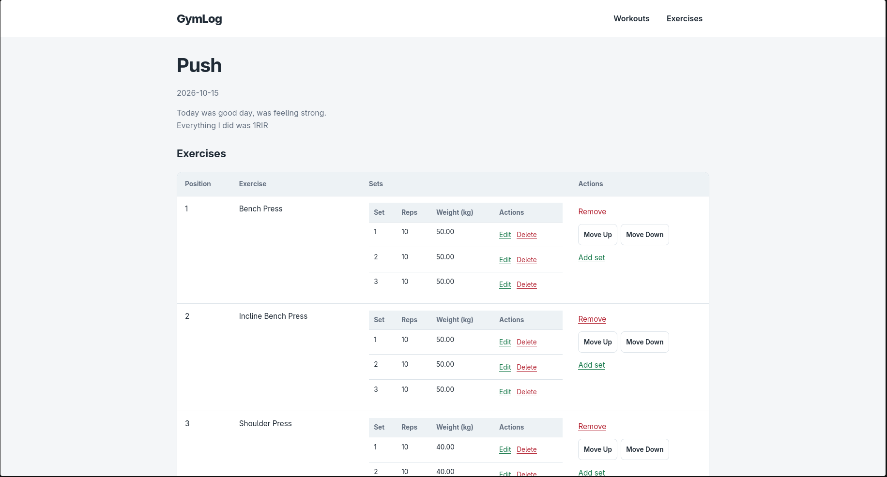

# Mario Lasić — Portfolio

A personal portfolio for presenting my skills and projects to potential employers. I am building it with Laravel and learning Vue through the project.

## Project status

The local implementation is complete and has passed its final feature, accessibility and build checks.
The home page includes an introduction, About, skills and a CV request card.
The project listing has responsive cards. Individual project pages render Markdown descriptions and show
technologies, status and a source-code link. The screenshot carousel has manual controls and a changing
image caption. The contact form includes validation, local email logging, delivery and network error
feedback, rate limiting and a honeypot. A styled 404 page provides a route back home.

The source code remains public on GitHub and can be run locally. Public deployment is planned after a
larger showcase project has been completed and added to the portfolio.

Implemented features:

- An introduction and skills overview.
- A project listing and individual project pages with descriptions and screenshots.
- A CV request card linking to the contact section.
- A contact form.
- A custom, responsive design.
- Page-specific SEO metadata, sharing artwork, a favicon, sitemap and robots response.

Public deployment remains pending. See [deployment and maintenance](docs/deployment.md) for the future
release procedure and its outstanding prerequisites.



The image above is a project screenshot displayed by the portfolio, not a public GymLog demo.

## Technology

- Laravel 13
- Vue 3 with JavaScript
- Inertia.js 3
- Vite 8

The default local setup uses SQLite for Laravel infrastructure, including database-backed sessions and cache.

## Requirements

- PHP 8.4.1 or newer, compatible with the committed Composer lock file; development verified with PHP 8.5.
- The PHP extensions required by Laravel, including PDO SQLite.
- Composer 2.
- Node.js 22.12 or newer and npm.

## First-time local setup

The following commands use a Unix shell:

```bash
git clone https://github.com/mario-lasic/portfolio.git
cd portfolio
composer install
npm ci
cp .env.example .env
php artisan key:generate
touch database/database.sqlite
php artisan migrate
```

The default environment example uses SQLite and logs outgoing mail locally. In your new `.env`, set:

```dotenv
APP_NAME="Mario Lasić Portfolio"
APP_URL=http://127.0.0.1:8000
MAIL_MAILER=log
MAIL_CONTACT_TO=recipient@example.com
```

Use the same host and port in `APP_URL` and the browser. `recipient@example.com` is a local log-only
example; replace it with your receiving address when configuring delivery. A non-empty recipient is
required even with the log transport. Keep the `.env` file private.

After changing cached configuration, run `php artisan config:clear` and restart any open Tinker session.

Before running tests or serving a fresh copy without Vite, generate the production assets:

```bash
npm run build
php artisan test
```

The clean-copy check confirmed this order. Generated Vite and font assets are not committed, so a fresh
clone needs its own build. The application was successfully checked from a separate clone, including
Home, Projects, GymLog, CV request card, 404 and contact logging.

## Local development

Start Laravel in one terminal:

```bash
php artisan serve
```

Start Vite in a second terminal, from the project directory:

```bash
npm run dev
```

Open [http://127.0.0.1:8000](http://127.0.0.1:8000).

Current routes:

| Route | Page |
| --- | --- |
| `/` | Home |
| `/projects` | Projects |
| `/projects/{slug}` | Project details; unknown slugs and placeholders return 404 |
| `POST /contact` | Validate and process a contact message |
| `/sitemap.xml` | Public page URLs from configuration |
| `/robots.txt` | Sitemap reference |

## Contact and automated checks

The contact form requires a name of at most 100 characters, an email of at most 254 characters, and a
message of 10–5000 characters. The visitor's email is Reply-To; the application's configured address is
From. Blade escapes the submitted text and preserves line breaks.

Local messages are written to `storage/logs/laravel.log`. The log transport does not deliver to an inbox.
Production HTTPS API delivery is still to be implemented and verified before publication.

After validation, the limiter permits three attempts per IP in a 60-second window; transport failures
also count. A populated hidden `website` field blocks sending before counting. Input is retained after
validation, delivery, network or rate-limit errors; successful requests reset the form. The submit button
is disabled while processing. Field errors have associated descriptions, delivery errors use an alert,
and successful submission has a status message.

Run the full suite after the initial build (rebuild when frontend assets change):

```bash
php artisan test
```

The latest local check passed 22 tests with 115 assertions. Tests cover contact validation boundaries,
recipient and Reply-To, transport failure, rate limiting, honeypot blocking, initial HTML metadata,
Inertia metadata, sitemap, robots and project 404 responses. Mail is intercepted during feature tests.
Rate-limit state for the default test IP is cleared before each contact test.

## SEO and sharing

Home, Projects and real project detail pages include page-specific titles, descriptions, canonical links,
Open Graph and large-image sharing metadata. Laravel renders these into the initial HTML; the shared
`SeoHead` Vue component updates the same tags during Inertia navigation without duplicating them.
Metadata comes from `App\Support\Seo`. Project descriptions use their configured summaries.

Absolute canonical, sharing-image and sitemap URLs use `APP_URL`. Its local value is expected during
local development. Before deployment, set it to the final public HTTPS origin, refresh cached
configuration, and verify the initial HTML and sharing previews on the public site. No production URL
has been selected yet. Do not publish with a localhost `APP_URL`.

`/sitemap.xml` lists Home, Projects and real project detail pages from the project configuration; it
excludes placeholders and the contact POST endpoint. `/robots.txt` is generated by Laravel and points
to that sitemap. The SVG ML favicon and 1200 × 630 PNG sharing image use the portfolio palette.

## Adding a project

1. Choose a unique slug and write the project's Markdown description in
   `resources/content/projects/<slug>/details.md`.
2. Add its screenshots under `public/images/<slug>/`.
3. Add a record to the array returned by `config/projects.php`, using GymLog as the reference:
   - `slug`, `title`, a short `summary`, `technologies` as an array of names, and an accurate `status`.
   - `cover_image` as a public URL such as `/images/<slug>/cover.png`.
   - `github_url` for the source repository; use `null` when unavailable. Keep `demo_url` as `null`
     when there is no public demo.
   - `images` as an ordered array of `src`, descriptive `alt` and short visible `caption` values.
     Include the image's actual `width` and `height`. The current card reads its cover dimensions and
     alternative text from the first image record, so keep that image aligned with `cover_image`.
     Image URLs start with `/images/`, without a `/public` prefix.
   - `content_file` relative to `resources`, such as `content/projects/<slug>/details.md`.
   - Omit `is_placeholder` or set it to `false` for a real project.
4. If a technology needs an icon, add its SVG to `public/icons/skills/` and map the exact technology name
   in `technologyIcons` in `resources/js/Pages/ProjectDetails.vue`. Names without an icon still appear as text.
5. Check the listing and `/projects/<slug>`, the source-code link, Markdown headings, all images and their
   captions. Check narrow and wide layouts, keyboard controls and the production build before committing.

The existing project listing, detail page and gallery render the new record. Coming soon entries use
`is_placeholder: true`; they have no details link, and direct requests to their slug return 404.

Gallery controls keep focus on the activated button. Previous and Next announce unavailable states at
the ends of the list, while their functions prevent the index leaving the array. A single image hides the
controls; an empty images array hides the gallery. The caption announces position and description politely.

## Check production assets locally

Stop the Vite development server, then build the frontend assets:

```bash
npm run build
```

Keep the Laravel development server running and refresh the browser. Laravel will load the generated assets from `public/build`.

## Manual checks

- Open Home, Projects and `/projects/gymlog` directly and refresh each page.
- Check that unknown project slugs and `/projects/coming-soon` return 404.
- Navigate between Home and Projects using their links.
- Check the browser's Back and Forward buttons.
- Check the browser console for errors.
- Confirm that the pages also work with built assets after stopping Vite.

- Check skip navigation, visible keyboard focus, the mobile menu and form error focus.
- Submit a short message, then a valid message and inspect its log entry.
- Confirm a fourth validated attempt is blocked, and retry after the limit expires.
- Use browser Offline mode to check the network error and retained input; restore Online and retry.
- Open `/sitemap.xml` and `/robots.txt`; inspect page titles, descriptions and canonical links.
- Check keyboard controls, narrow layouts and 200% browser zoom.

## Current limits

- No public deployment or production inbox-delivery verification yet.
- GymLog runs locally; Coming soon is an explicit placeholder with no detail page.
- Projects use configuration and repository-authored Markdown; there is no admin interface or content database.
- There is no Vue SSR service. SEO head tags are provided by Blade, while page content renders through Vue.
- Original screenshots are retained. Lighthouse reported an oversized card image; smaller variants are a deferred improvement.
- Manual keyboard and zoom checks have passed; a dedicated screen-reader audit has not been performed.

## Development approach

I built this as a learning portfolio, using AI-assisted mentoring for planning, explanations, reviews
and selected implementations. The project combines Laravel backend work with learning Vue and Inertia.
